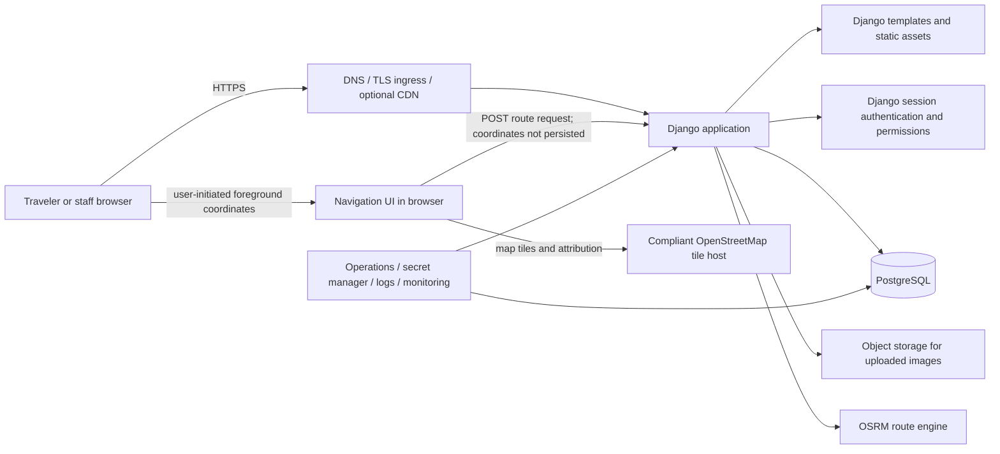
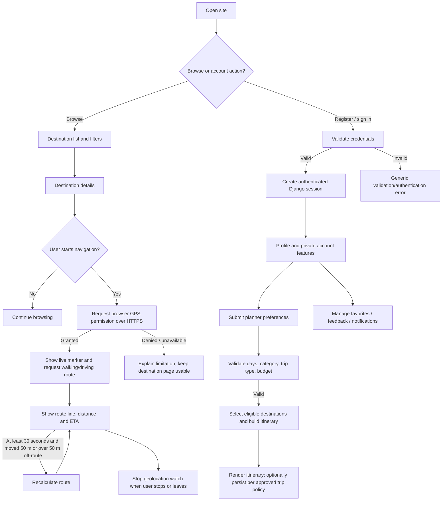

# KumariQuest — Technical Architecture

**Status:** Proposed target architecture based on the current Django application. The diagrams describe the recommended production direction; they do not imply that these production components or the JSON API are implemented.

## 1. Recommended stack

| Layer | Recommendation | Rationale / status |
|---|---|---|
| Language/runtime | Python; keep the repository's tested Python/Django pairing and upgrade deliberately | Current local environment runs Python 3.14 with Django 6.1.1. Pin supported versions after CI validation. |
| Web/backend | Django monolith, split into `accounts`, `tourism`, and `planner` domains | Reuse current code, ORM, migrations, session auth, admin, and templates; no microservices. |
| HTML frontend | Django templates with progressive enhancement using small, local JavaScript | Matches existing server-rendered UI; avoids a separate SPA build/deployment. |
| JSON API | Django REST Framework for the proposed `/api/v1/` contract | Provides serializers, permissions, pagination, and testable JSON behavior if API scope is approved. It is not installed/used by the current app. |
| Database | PostgreSQL in production; SQLite for local quick start if desired | PostgreSQL offers robust concurrent writes, constraints, backups, and production operations. |
| Media | Private or public object storage behind an image-serving/CDN layer; image validation at upload | Avoid storing production uploads on ephemeral app disks. Provider remains undecided. |
| Static assets | Django static collection and a static file host/CDN (or WhiteNoise for a simple deployment) | Static and user-uploaded media have different lifecycle and access needs. |
| Authentication | Django session authentication with secure, HttpOnly cookies and CSRF protection | Appropriate for same-origin web UI; avoids unnecessary JWT/refresh-token complexity. |
| Maps/navigation | Leaflet with OpenStreetMap-compatible map data/tiles and an OSRM-based route engine | User-approved foreground-only GPS, walking/driving route overview, no voice/turn-by-turn. Tile and routing hosts/terms still require an operational decision; open-source software does not guarantee free production hosting. |
| Tests | Django test framework; add browser-level E2E tooling only for critical flows | No tests currently exist; start with domain, view/API, permission, and template tests. |
| Hosting | Managed application runtime, managed PostgreSQL, object storage, HTTPS, secret manager | Operationally simpler than self-managing databases and file storage. Provider selection is open. |

Do not install every package in the current `requirements.txt` for this app. Replace/organize it only as a separately reviewed dependency-maintenance task after confirming the deployed environment.

## 2. High-level architecture



In the initial deployment, one Django deployment serves HTML pages and the versioned JSON API, with an OSRM service alongside it or at a reviewed hosted endpoint. A separate frontend service, worker queue, or cache is not justified until measured requirements need it.

## 3. Application workflow



The browser sends same-origin requests. State-changing browser/API requests use CSRF protection. Browser geolocation starts only after a user action and permission. Coordinates remain in page memory, are sent in a POST to the route service, and are not saved to the database, browser storage, or logs. The selected routing host processes coordinates to calculate the route; disclose that transfer. Map-tile requests may also reveal an approximate viewport to the tile host.

## 4. Authentication and authorization flow

```mermaid
sequenceDiagram
    actor Traveler
    participant Browser
    participant Django as Django app
    participant DB as PostgreSQL
    Traveler->>Browser: Submit registration or login form
    Browser->>Django: HTTPS POST + CSRF token
    Django->>Django: Validate fields / authenticate
    Django->>DB: Read/write user and password hash
    DB-->>Django: User record
    Django-->>Browser: Set secure session cookie; redirect or JSON response
    Browser->>Django: Later request with session cookie
    Django->>Django: Resolve user and check view/object permission
    Django->>DB: Read/write only authorized records
    Django-->>Browser: Response
    Traveler->>Browser: Sign out
    Browser->>Django: CSRF-protected POST
    Django->>Django: Invalidate session
```

Use Django password hashers; never store or log plaintext passwords. Rotate the session on authentication, use secure cookie settings in production, apply CSRF protection, and require ownership checks for every user-owned object. Use Django groups/permissions for staff; do not treat a hidden UI link as authorization.

## 5. Backend and frontend boundaries

- `accounts`: registration, sign-in/out, profile, account lifecycle, current-user endpoint.
- `tourism`: public destination reads; staff-controlled destination writes; favorites, feedback/reviews, notifications.
- `planner`: validation, filtering/ranking, itinerary construction and approved persistence behavior.
- `tourism` navigation integration: validate destination coordinates and route mode; call OSRM through a bounded service; return route geometry/distance/duration without persisting origin coordinates.
- `templates/`: server-rendered pages; forms post to Django views/API.
- `static/`: first-party CSS/JavaScript, including a navigation module that starts/stops `watchPosition`. Keep third-party scripts limited, pinned where practical, and governed by CSP.
- API serializers/views must call the same domain rules as HTML flows; avoid divergent validation.

## 6. API architecture

The repository currently has HTML routes only. If approved, introduce a versioned `/api/v1/` JSON interface using Django REST Framework. Keep it in the same deployment and database. Use session authentication for the same-origin browser, CSRF on unsafe requests, stable pagination, explicit serializers, and consistent JSON errors. Do not expose Django model serialization directly. The proposed public `POST /api/v1/navigation/routes` endpoint accepts a destination ID, transient origin coordinates, and `walking`/`driving` mode; it validates and forwards them to OSRM, returns a route overview, and never saves the origin.

If a separate mobile or third-party client is later approved, revisit authentication (possibly OAuth/OIDC or token-based), CORS, rate limits, and API lifecycle rather than enabling permissive cross-origin access pre-emptively.

## 7. Data and consistency

- Foreign keys use database constraints; ORM validation is not a substitute for authorization.
- Unique `(user_id, destination_id)` constraint prevents duplicate favorites.
- Add a check constraint for review rating 1–5 and a positive supported trip-day range.
- Index common destination category/name filters and owner/date ordered account lists as workload warrants.
- Persist itinerary stops only after the product decision; use an ordered child table if persisted itineraries are required.
- Public content should have an explicit publication state if drafts must not leak.
- Database and media backups must be coordinated; a database restore alone does not restore uploaded files.

## 8. Security, errors, and observability

- Production settings loaded from environment/secret manager; `DEBUG=False`, explicit `ALLOWED_HOSTS`, HTTPS redirect, secure cookies, HSTS after TLS verification.
- CSRF on all browser mutations; mutations must not use GET.
- Parameterized ORM queries; validate request schemas and bound strings/files/arrays.
- Restrict admin, enforce object ownership, and avoid returning private profile/email data in public serializers.
- Store uploads under generated names; verify actual image content, allowlist formats, cap file size/dimensions, and serve with safe content headers.
- Return field-level 400 errors, 401/403 as appropriate, 404 for inaccessible user-owned resources when avoiding existence disclosure, and 429 for rate limits.
- Log request correlation ID, route, status, duration, and safe error context; redact passwords, session IDs, tokens, exact GPS coordinates, and unnecessary personal data. Add error reporting/health checks before launch.
- Use Django's standard exception handling and structured API validation; do not convert unexpected errors into success-shaped responses.

## 9. External integrations

Current templates reference Google Maps and Leaflet/OSRM resources. The approved target is Leaflet + OpenStreetMap-compatible tiles + OSRM-based routing, subject to the following:

1. Select a tile service that permits the expected traffic; comply with OpenStreetMap attribution and tile-use policies. The public OSM tile servers are not an unlimited production CDN.
2. Select self-hosted OSRM or a reviewed host. A public OSRM demo service is not a production availability commitment. Walking requires a suitable OSRM profile/data build; driving and walking may have different coverage.
3. Keep map failures non-blocking to destination browsing; show a clear unavailable state and preserve an external directions fallback if approved.
4. Request browser geolocation only after a user action over HTTPS; explain use and routing-provider transfer. Use `watchPosition` only while the navigation view is active; clear the watcher on stop/page teardown.
5. Keep precise coordinates only in active page memory. Do not persist them in DB, browser storage, URLs, analytics, or logs. Route requests need bounds checks, rate limits, and coordinate redaction.
6. Show route line, distance, and estimated duration only; no voice or guaranteed turn-by-turn guidance is in the approved first scope. Do not promise route accuracy, opening hours, or destination data freshness without verified sources.

Initial route-refresh defaults: recalculate on navigation start, then only after at least 30 seconds and either at least 50 m movement since the last route origin or more than 50 m deviation from the route. Validate these values in field testing and retain server-side rate limits.

No email, payment, analytics, push, or booking integration is assumed. The settings currently define `MAILERS`, which is not Django's standard `EMAIL_BACKEND`; no working email delivery is established.

## 10. Deployment architecture

Recommended first production deployment: one managed Django web service behind HTTPS ingress; managed PostgreSQL; object storage for media; static file hosting; secret manager; centralized logs/error tracking; automated database/media backups and tested restore. Add a separate OSRM service or reviewed hosted routing endpoint and compliant tile host; budget for route data updates, storage, and capacity. Run migrations as a release step, not opportunistically on every request. Use a production WSGI server (for example Gunicorn if supported by the selected platform) and a health/readiness endpoint. Separate staging and production credentials/data.

Hosting provider/region, data residency, retention, backup recovery objectives, map tile host, OSRM hosting/data update process, and expected scale remain open decisions.
