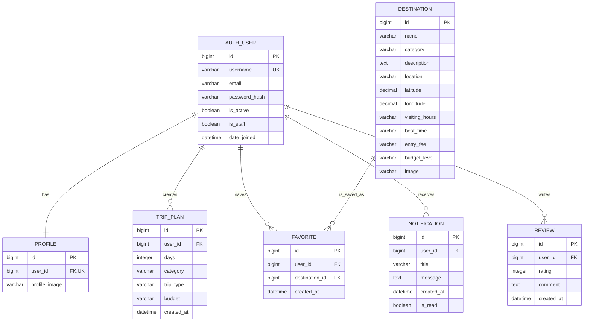

# KumariQuest — Database Design

**Status:** Existing columns below are derived from Django models/migrations. Proposed constraints, indexes, or extensions are explicitly identified; migrations have not been generated for them.

## 1. Design choices

- PostgreSQL is recommended for production. SQLite remains suitable for local development.
- Use Django's built-in `auth_user` model and auth tables until a custom-user requirement is confirmed. Changing the user model after production data exists is costly.
- The diagrams use Django's default `BigAutoField` primary keys and standard `auth_user.id` references.
- Timestamps are UTC-aware Django `DateTimeField`s (`USE_TZ=True`).
- Store image files outside the relational database; DB fields store storage-relative names.

## 2. Entity relationship diagram

The admin-authored destination relation in this overview is conceptual: the current `Destination` schema does **not** record a creator/editor. Add an audit relation only if content accountability requires it. Reviews intentionally have no destination FK in the current schema.

## 3. Table definitions

### 3.1 `auth_user` (Django built-in)

| Column | Type | Key / constraints | Notes |
|---|---|---|---|
| `id` | bigint | PK | Django default |
| `username` | varchar(150) | unique; non-empty | Login identifier in current UI |
| `password` | varchar(128) | non-null | Django encoded password hash; never plaintext |
| `email` | varchar(254) | nullable/blank by framework model | Registration form currently requires it, but uniqueness/verification is not enforced |
| `is_active`, `is_staff`, `is_superuser` | boolean | defaults per Django | Authorization flags; staff/admin must be restricted |
| `date_joined`, `last_login` | datetime | nullable/default per Django | Account lifecycle |
| Other name fields | varchar | framework-defined | Retain standard fields unless product requirements justify custom model |

Indexes: username unique index; Django creates standard auth indexes. Do not log password, session, or reset tokens.

### 3.2 `accounts_profile`

| Column | Type | Key / constraints | Notes |
|---|---|---|---|
| `id` | bigint | PK | Django default |
| `user_id` | bigint | FK to `auth_user.id`, unique, cascade delete | One profile per user |
| `profile_image` | varchar(100) storage key | nullable/blank | ImageField; validate content, size, and storage permissions |

The OneToOne FK's unique index supports lookup by user. No separate user index is needed.

### Location data (no table by design)

The approved first version does not persist GPS history. The browser holds the current fix only in active navigation page memory and posts coordinates only when requesting a route. Do not add a location-history table, write coordinates into Django sessions, browser storage, analytics, or ordinary request logs. The routing service necessarily processes the origin transiently; provider logging/retention must be configured and disclosed. The existing destination latitude/longitude fields describe fixed public places, not user locations.

### 3.3 `tourism_destination`

| Column | Type | Key / constraints | Notes |
|---|---|---|---|
| `id` | bigint | PK | Django default |
| `name` | varchar(200) | non-null | Human-readable title; current model does not require uniqueness |
| `category` | varchar(100) | non-null | Free-form today; define allowed categories before enforcing choices |
| `description` | text | non-null | Render as escaped plain text unless rich text is explicitly sanitized |
| `location` | varchar(200) | non-null | Human-readable location |
| `latitude`, `longitude` | decimal(9,6) | nullable | Needed for in-app routes; add paired-coordinate check (both null or both present) and validate latitude −90..90 / longitude −180..180 |
| `visiting_hours`, `best_time` | varchar(100) | non-null | Free-form descriptions |
| `entry_fee` | varchar(100) | default `"Free"` | Display text, not a normalized monetary amount |
| `budget_level` | varchar(50) | default `"Budget"` | Current planner expects Budget/Moderate/Luxury-like values |
| `image` | varchar(100) storage key | nullable/blank | Actual file stored outside DB |

Recommended indexes: `category` for filters; `(category, name)` if measured query patterns justify it. Add a normalized/search index only after defining case/accent-insensitive search. Avoid claiming coordinate-based proximity queries without a spatial extension/design.

### 3.4 `tourism_favorite`

| Column | Type | Key / constraints | Notes |
|---|---|---|---|
| `id` | bigint | PK | Django default |
| `user_id` | bigint | FK to auth user, cascade delete | Owner |
| `destination_id` | bigint | FK to destination, cascade delete | Saved destination |
| `created_at` | datetime | non-null, auto-created | Save time |

Required unique constraint: `(user_id, destination_id)` (present as `unique_together` in current model). This also provides an index for a user's favorites. Add `(destination_id, user_id)` only if reverse lookup is needed.

### 3.5 `planner_tripplan`

| Column | Type | Key / constraints | Notes |
|---|---|---|---|
| `id` | bigint | PK | Django default |
| `user_id` | bigint | FK to auth user, cascade delete | Owner |
| `days` | integer | non-null | Add check 1–5 if that remains the product limit |
| `category` | varchar(100) | non-null | Free-form today; validate against canonical choices |
| `trip_type` | varchar(50) | non-null | Current UI values include Family, Couple, Solo, Friends |
| `budget` | varchar(50) | non-null | Current UI values include Budget, Moderate, Luxury |
| `created_at` | datetime | non-null, auto-created | Planner submission time |

Recommended index: `(user_id, created_at DESC)` for profile history. The current table stores preferences only, not day stops. If full itineraries must be saved, add a separate `TripStop` table keyed to a trip with `day_number`, `position`, and destination FK; decide handling if a destination is deleted before introducing that schema.

### 3.6 `tourism_notification`

| Column | Type | Key / constraints | Notes |
|---|---|---|---|
| `id` | bigint | PK | Django default |
| `user_id` | bigint | FK to auth user, cascade delete | Recipient |
| `title` | varchar(200) | non-null | |
| `message` | text | non-null | Escape on render |
| `created_at` | datetime | non-null, auto-created | |
| `is_read` | boolean | non-null, default false | State mutation must be owner-scoped and use POST/PATCH |

Recommended index: `(user_id, is_read, created_at DESC)` for unread count and recent listing.

### 3.7 `tourism_review`

| Column | Type | Key / constraints | Notes |
|---|---|---|---|
| `id` | bigint | PK | Django default |
| `user_id` | bigint | FK to auth user, cascade delete | Author |
| `rating` | integer | non-null | Add DB check `1 <= rating <= 5` |
| `comment` | text | non-null | Trim and bound length at request layer |
| `created_at` | datetime | non-null, auto-created | |

Current reviews are **site-wide**: migration `0007` removed the earlier destination FK. If product owners choose destination-specific reviews, add nullable/required `destination_id` in a reviewed migration and define behavior for destination deletion; do not silently infer this relationship. Consider moderation status and user/reporting policy before public launch.

### 3.8 Django framework tables

`django_session`, `django_content_type`, `auth_group`, `auth_permission`, `auth_group_permissions`, `auth_user_groups`, `auth_user_user_permissions`, and admin log tables are managed by Django. Retain framework migrations and default constraints; production session storage can remain in the database until measured need warrants another backend.

## 4. Relationships and deletion behavior

- User → Profile: one-to-one; profile cascades on user deletion.
- User → TripPlan/Favorite/Notification/Review: one-to-many; current FKs cascade.
- Destination → Favorite: one-to-many; destination deletion cascades favorites.
- Review → Destination: no relation currently.
- Deletion/retention policy for accounts, reviews, and notifications needs product/legal approval. Cascading user deletion removes dependent records; confirm this is desired and define backups/retention separately.

## 5. Integrity and consistency concerns

1. Free-form category, budget, and trip-type strings can diverge from planner filters; use shared choices/validation and deliberate data migrations.
2. Latitude/longitude can be mismatched or out of range; validate both-or-neither and geographic bounds.
3. `TripPlan.days` has no DB range constraint; direct API/admin writes could bypass form assumptions.
4. `Review.rating` has no DB constraint; the current view checks a range but malformed input can raise during integer parsing.
5. Favorite uniqueness exists in the DB model; all add flows must handle concurrent duplicate attempts gracefully.
6. User-owned object reads must filter by current user, not merely by primary key.
7. Itineraries reference live destinations only if a stop table is added; decide deletion/snapshot semantics (retain historical name snapshot, restrict delete, or remove stop).
8. File paths in DB do not guarantee files exist; storage lifecycle, orphan cleanup, and backup restore must be considered.
9. No review moderation/publication column exists; site-wide visibility is currently immediate.
10. A future custom user model, site-wide/destination review migration, and persisted-trip schema should be approved before first production data is loaded.
11. Destination coordinates may be absent, invalid, or inaccurate; route creation must reject missing/out-of-range destination coordinates and never assume every destination is routable.

## 6. Migration and indexing policy

- Commit migrations with schema changes and test both fresh database creation and upgrade from the current migration graph.
- Use `CheckConstraint`/`UniqueConstraint` for invariants that must hold across all write paths.
- Add indexes based on list filters/orderings; assess with PostgreSQL query plans and realistic data.
- Do not add a spatial database extension until proximity queries are an accepted requirement.
- No migration is required for transient user GPS tracking; destination coordinates already exist and need validation/data-quality checks.
- Back up production before destructive or data-transforming migrations and rehearse rollback/forward recovery.
