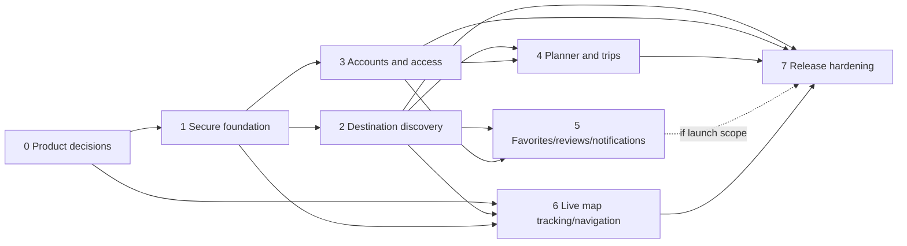

# KumariQuest — Implementation Plan

**Status:** Proposed, dependency-ordered plan for review. No implementation is authorized until the product decisions in `PROJECT_ANALYSIS.md` are approved.

## Delivery principles

- Keep the first release as one Django application with server-rendered pages.
- Implement security and validation before adding account-owned mutations.
- Retain existing behavior where it is correct; do not advertise partial features as complete.
- Each checkpoint ends with tests and an acceptance review. Do not begin a dependent checkpoint with a failing gate.
- Estimates assume one intermediate developer working part-time on an existing codebase; they are planning ranges, not commitments.

## Checkpoint 0 — Product decisions and baseline

- **Priority / estimate:** P0; 1–2 days.
- **Objective:** Agree on MVP and close blocking product questions.
- **Features:** Approve geography, trip persistence, review semantics/moderation, account lifecycle, maps/location, hosting, and license.
- **Files/folders:** Review existing repository; approve/update `PROJECT_ANALYSIS.md`, `ARCHITECTURE.md`, and this plan. No application changes.
- **Backend / frontend / DB / API:** None.
- **Validation/security/tests:** Record current checks, routes, migrations, and missing tests. Confirm no secrets/data are copied to docs.
- **Acceptance criteria:** Every blocking decision has an owner and answer or an explicit deferral; MVP requirements have measurable acceptance criteria.
- **Expected output:** Approved scope baseline; implementation remains paused until approval.

## Checkpoint 1 — Secure, reproducible foundation

- **Priority / estimate:** P0; 2–4 days.
- **Depends on:** Checkpoint 0.
- **Objective:** Make local and CI behavior reproducible and prevent development settings from being mistaken for production settings.
- **Features:** Separate development/production configuration; environment-sourced secret; explicit hosts; requirements limited/organized for this application; basic CI for checks/tests; health check/logging conventions.
- **Likely files:** `kumariquest/settings.py` or split settings modules; dependency manifest/lock; `.env.example`; `.gitignore`; CI configuration; tests.
- **Backend:** Environment parsing, safe defaults, Django deployment check, static/media configuration.
- **Frontend:** No feature changes; preserve templates.
- **Database:** Continue SQLite locally; add PostgreSQL service/config for CI/staging.
- **API:** None unless the API scope is approved.
- **Validation:** Clean environment install; migrate from empty DB; `manage.py check`; production `check --deploy` configured with staging values.
- **Security:** Remove committed development secret from active settings; ensure real production secret rotation if ever used; `DEBUG=False`, HTTPS and cookie settings, restrictive hosts; no secrets in CI logs.
- **Tests:** Configuration tests, migration smoke test, health response; CI runs existing suite (initially 0 tests must be remedied in later checkpoints).
- **Acceptance criteria:** A new developer can install only declared app dependencies and run the app; production startup fails clearly on missing critical secrets/config; no insecure development fallback in production.
- **Expected output:** Repeatable local/CI foundation.

## Checkpoint 2 — Destination domain and public discovery

- **Priority / estimate:** P0; 3–5 days.
- **Depends on:** Checkpoint 1.
- **Objective:** Stabilize public destination browsing and content management.
- **Features:** Destination list/detail, category/search filter, optional image/coordinates, admin content workflow and empty states.
- **Likely files:** `tourism/models.py`, `tourism/views.py`, `tourism/urls.py`, `tourism/admin.py`, `templates/home.html`, `templates/explore.html`, `templates/destination_detail.html`, static assets, tourism tests, migrations if needed.
- **Backend:** Shared validated filter rules; pagination if catalog size requires; 404 for missing destination; explicit published status only if drafts are needed.
- **Frontend:** Accessible labels, keyboard behavior, mobile layout, missing image/coordinate states, external links with safe `rel` attributes.
- **Database:** Confirm category vocabulary and content source; add only justified indexes/constraints.
- **API:** Proposed `GET /api/v1/destinations` and `GET /api/v1/destinations/{id}` if API is approved; otherwise HTML only.
- **Validation:** Search/category and detail pages; safe text rendering; valid/invalid coordinate cases; admin form validation.
- **Security:** Escaped template output; staff-only content editing; image constraints and storage policy.
- **Tests:** Model constraints, list filters, detail 404, unpublished visibility (if applicable), template rendering.
- **Acceptance criteria:** Visitors can locate and inspect a destination on supported browsers/mobile widths; no unsupported content is fabricated; missing optional fields do not break a page.
- **Expected output:** Tested public destination experience and documented content workflow.

## Checkpoint 3 — Accounts, profile, and access controls

- **Priority / estimate:** P0; 4–6 days.
- **Depends on:** Checkpoint 1; integrates with Checkpoint 2.
- **Objective:** Make registration and account-owned data safe and reliable.
- **Features:** Register, login, POST logout, profile view/edit, password-change behavior, profile image handling; password reset/email verification only if approved.
- **Likely files:** `accounts/views.py`, `accounts/urls.py`, `accounts/models.py`, forms/serializers/permissions, `kumariquest/urls.py`, account templates, tests, migrations if schema changes.
- **Backend:** Django forms or DRF serializers for input; generic auth errors; use login/logout helpers; owner scoping; validation and transaction boundaries.
- **Frontend:** Accessible form labels/errors; preserve entered non-secret values when appropriate; never repopulate passwords.
- **Database:** Keep Django User unless custom identity requirements are approved; profile relationship remains one-to-one.
- **API:** `POST /api/v1/auth/register`, session login/logout, `GET/PATCH /api/v1/me` only if API approved.
- **Validation:** Duplicate usernames, email format policy, password validators, malformed posts, unauthorized and cross-user requests.
- **Security:** CSRF, secure sessions, no GET state changes, rate-limit or otherwise protect credential endpoints, safe redirects, file upload verification/size limits.
- **Tests:** Registration/login/logout, inactive user, session rotation, CSRF configuration, profile ownership, password change, upload rejection.
- **Acceptance criteria:** Authenticated requests cannot cross account boundaries; invalid inputs return understandable errors; profile updates do not weaken session security.
- **Expected output:** Reliable account and profile workflows.

## Checkpoint 4 — Planner and trip persistence

- **Priority / estimate:** P0; 3–5 days for planner validation; add 2–4 days if persistent stop records are approved.
- **Depends on:** Checkpoint 2 and Checkpoint 3 for saved trips.
- **Objective:** Make itinerary output deterministic, validated, and consistent with product policy.
- **Features:** 1–5 days, category, trip type, budget; understandable empty results; trip record policy; profile history.
- **Likely files:** `planner/views.py`, `planner/models.py`, planner domain/service helper, `planner/urls.py`, `templates/planner.html`, migrations and tests.
- **Backend:** Validate enumerated values and bounds before querying; avoid repeated per-day query work; deterministic day assignment; persist only after successful validation.
- **Frontend:** Preserve selected values, explain no results, expose day-by-day output accessibly.
- **Database:** Add days check constraint and owner/date index. Add ordered `TripStop` only if approval confirms itinerary stops are saved.
- **API:** `POST /api/v1/plans`, `GET /api/v1/me/plans`, and owned detail/delete if required.
- **Validation:** No destinations, fewer destinations than days, invalid day values, bad category/budget, logged-out user, duplicate submissions.
- **Security:** Enforce owner-only history; prevent tampering with user ID; bound request size and processing.
- **Tests:** Unit tests for selection/ordering; view/API tests for input validation and saved ownership; migration tests.
- **Acceptance criteria:** Valid input yields exactly the requested day groups, with destinations assigned at most once unless product approves repetition; invalid input never creates a plan; saved data matches approved semantics.
- **Expected output:** Predictable planner and explicit persistence behavior.

## Checkpoint 5 — Favorites, reviews, notifications, and moderation

- **Priority / estimate:** P1; 5–8 days.
- **Depends on:** Checkpoints 2 and 3; Checkpoint 0 review/notification decisions.
- **Objective:** Complete account features currently represented only partly by models or views.
- **Features:** Favorite add/remove/list; feedback/reviews and moderation; notification list and owner-scoped read mutation; notification creation rules.
- **Likely files:** `tourism/models.py`, `tourism/views.py`, `tourism/urls.py`, `tourism/admin.py`, tourism templates, forms/serializers/permissions, migrations, tests.
- **Backend:** Idempotent favorite behavior; explicit review policy and moderation; notification event/service interface only after event rules are approved.
- **Frontend:** Add/remove controls, empty/error states, read/unread state, moderation reporting if needed.
- **Database:** Enforce favorite uniqueness, rating constraint, notification listing index; optional review destination/status fields only after decision.
- **API:** Favorites CRUD, reviews list/create, notifications list/read PATCH if approved.
- **Validation:** Duplicate favorite, invalid rating, blank/oversized review, invalid notification, non-owner access.
- **Security:** POST/PATCH/DELETE for mutations; CSRF; ownership checks; rate-limit abusive submissions; safe output encoding; staff-only moderation.
- **Tests:** Duplicate/concurrent favorite handling, rating edges, review visibility, notification owner isolation and mutation methods.
- **Acceptance criteria:** Each enabled feature has a complete user flow, no cross-user access, and documented moderation/notification behavior.
- **Expected output:** Complete approved P1 account engagement features.

## Checkpoint 6 — Live map tracking and route overview

- **Priority / estimate:** P0; 6–10 days, including routing-service setup and verification.
- **Depends on:** Checkpoint 0 (tile/routing host, terms, privacy, operating-cost decision) and Checkpoint 2 (verified destination coordinates); Checkpoint 1 for HTTPS, safe logs, and configuration.
- **Objective:** Deliver user-initiated foreground GPS tracking and in-app route overview for selected destinations.
- **Features:** Leaflet map using compliant OpenStreetMap-compatible tiles; browser `watchPosition` while active; route line, distance, and ETA for walking/driving; route refresh initially only after at least 30 seconds and either 50 m movement since the last route origin or more than 50 m off-route; explicit stop; fallback if denied/unavailable. No background tracking, coordinate history, turn-by-turn, or voice guidance. Tune thresholds with field testing.
- **Likely files:** `templates/destination_detail.html`; `static/js/navigation.js`; `tourism/routing.py`; approved API view/serializer/routes (for example `tourism/api_views.py` and `tourism/api_urls.py`); settings/CSP; destination data validation; `tourism/tests/`; README/privacy/operations docs.
- **Backend:** Validate destination and origin coordinate ranges and supported mode; call a configured OSRM service with strict timeout/response bounds; return normalized GeoJSON route overview; rate-limit requests; never persist or log origin coordinates. Decide whether OSRM is self-hosted or a reviewed host and document graph/profile updates.
- **Frontend:** Request geolocation only after a clear user action and permission; show permission/accuracy/loading/error states; update marker; clear watcher on stop/page teardown; maintain usable destination details if maps/routes fail; show OSM attribution.
- **Database:** No user-location table or migration. Validate existing destination latitude/longitude pair and ranges; absent/invalid destination coordinates make navigation unavailable.
- **API:** Implement the proposed `POST /api/v1/navigation/routes` from `API_DOCUMENTATION.md`; no login required, but enforce CSRF for same-origin session browser, coordinate validation, timeout, and rate limit.
- **Validation:** HTTPS/secure context; supported browser; permission grant/denial/revocation/timeout; walking/driving; invalid/missing destination coordinates; jitter, route refresh, OSRM outage and malformed response.
- **Security:** Explain routing-provider transfer; keep origin in active page memory only; redact origin in application, proxy, and route-service logs; do not put coordinates in URL, browser storage, analytics, DB, or error output; CSP and provider policy/attribution review.
- **Tests:** Mock Geolocation API and OSRM responses; assert watcher cleanup; marker updates for new fixes; route recalculation respects movement/deviation thresholds and 30-second minimum interval; API validation/status/CSRF/rate limits; no persistence/logging; ensure core browse/detail works during provider outage.
- **Acceptance criteria:** Location is never requested before explicit start; position marker follows while active and stops when ended; valid walking/driving request shows route geometry, distance, and ETA; route refresh follows the documented initial thresholds and server limits; unsupported/denied/low-quality GPS and missing coordinates fail clearly; no precise coordinates are retained beyond the active browser page or exposed in logs.
- **Expected output:** Tested live map route-overview feature and an operationally supported OpenStreetMap/OSRM arrangement.

## Checkpoint 7 — Release hardening and operations

- **Priority / estimate:** P0 before public release; 4–7 days plus operational setup.
- **Depends on:** All P0 feature checkpoints; P1 checkpoints only if included in launch scope.
- **Objective:** Operate the approved MVP safely.
- **Features:** Staging/production deployment, backups, monitoring, static/media storage, rollback/restore procedures, release checklist.
- **Likely files:** deployment manifests/configuration, CI/CD, production settings, operational runbook and README updates.
- **Backend:** Production WSGI server, health checks, bounded request/body sizes, safe error pages and structured logs.
- **Frontend:** Production static assets, no debug output, accessibility and responsive regression checks.
- **Database:** Managed PostgreSQL, automated backups, migration release task, restore test.
- **API:** Rate limits and schema/version documentation for exposed API routes.
- **Validation/security/tests:** `check --deploy`, dependency audit, OWASP-oriented test pass, backup restore, smoke/E2E critical journeys, TLS/Cookie/CSP checks.
- **Acceptance criteria:** Release checklist passes; rollback and restore are rehearsed; no known critical/high security issue; core journeys meet agreed targets.
- **Expected output:** Approved production release candidate and operations handoff.

## Dependency graph



## Roadmap and effort summary

| Milestone | Checkpoints | Priority | Estimate |
|---|---|---|---:|
| Approved, testable scope | 0 | P0 | 1–2 days |
| Secure, reproducible foundation | 1 | P0 | 2–4 days |
| Public discovery MVP | 2 | P0 | 3–5 days |
| Safe account workflows | 3 | P0 | 4–6 days |
| Validated itinerary planner | 4 | P0 | 3–5 days (+2–4 if stop persistence) |
| Engagement features | 5 | P1 | 5–8 days |
| Live map tracking/navigation | 6 | P0 | 6–10 days |
| Production readiness | 7 | P0 | 4–7 days plus hosting setup |

Rough MVP total (Checkpoints 0–4, 6, and 7): **23–39 developer-days**, excluding provider procurement, content creation, and review/approval wait time. Add 2–4 days if persistent itinerary stops are approved. Single-developer calendar duration depends on availability and decision turnaround.

## Proposed project folder structure

This is a target, not a claim that these files already exist. Add files only when their checkpoint needs them; keep the architecture modular without introducing generic layers prematurely.

```text
KumariQuest/
├── .github/
│   └── workflows/
│       └── ci.yml                 # Dependency install, Django checks, tests
├── accounts/
│   ├── migrations/
│   ├── tests/                     # Account, profile, session, permissions
│   ├── forms.py                   # Server-rendered account form validation
│   ├── serializers.py             # Proposed JSON API request/response validation
│   ├── urls.py
│   └── views.py                   # Account and profile workflows
├── kumariquest/
│   ├── settings/
│   │   ├── base.py                # Shared configuration
│   │   ├── development.py         # Local-only defaults
│   │   └── production.py          # Fail-closed production configuration
│   ├── asgi.py
│   ├── urls.py                    # Root HTML/API route includes
│   └── wsgi.py
├── planner/
│   ├── migrations/
│   ├── tests/                     # Planner rules, boundaries, ownership
│   ├── forms.py
│   ├── serializers.py             # Only if JSON API is approved
│   ├── services.py                # Itinerary selection and ordering rules
│   ├── urls.py
│   ├── api_urls.py                # Only if JSON API is approved
│   └── views.py
├── tourism/
│   ├── migrations/
│   ├── tests/                     # Destinations, favorites, reviews, notices
│   ├── forms.py
│   ├── serializers.py             # Only if JSON API is approved
│   ├── services.py                # Shared moderation/favorite/notice rules
│   ├── routing.py                 # OSRM adapter; transient route requests only
│   ├── urls.py
│   ├── api_urls.py                # Only if JSON API is approved
│   └── views.py
├── templates/                     # Server-rendered pages and shared fragments
├── static/
│   ├── css/                       # First-party styles
│   └── js/
│       ├── navigation.js          # Foreground GPS and route overview UI
│       └── ...                    # Small first-party enhancements
├── docs/                          # Approved architecture and product documents
├── .env.example                   # Variable names and safe placeholders only
├── .gitignore                     # Ignore local secrets, DB, uploads, venv
├── manage.py
├── requirements.txt               # Reviewed app-specific dependencies
├── requirements-dev.txt           # Optional test/lint tooling, if selected
└── README.md
```

### Folder responsibilities

- `accounts/`, `tourism/`, and `planner/` own their domain models, routes, validations, and tests; cross-domain rules should use a small explicit service rather than be duplicated.
- `services.py` is reserved for business logic shared by more than a trivial view; do not create an abstraction for every model operation.
- `serializers.py` and `api_urls.py` are conditional on API approval. HTML forms remain the primary UI.
- `kumariquest/settings/` separates environment configuration while sharing secure common settings; do not commit real `.env` values.
- `templates/` and `static/` keep presentation concerns out of model/business rules.
- `docs/` contains the approved deliverables in this plan. Tests belong near their owning Django app.
- Uploaded media is runtime data in configured storage, not a source-controlled project folder.

## Release criteria

- All approved P0 requirements meet acceptance criteria and have automated tests.
- `manage.py check`, migration checks, test suite, dependency review, and production deployment checks pass.
- No debug configuration, source-controlled secrets, unsafe state-changing GET requests, or unowned-object access.
- HTTPS, secure session/CSRF cookies, database/media backups, and a successful restore test are in place.
- Critical user journeys pass on supported desktop/mobile browsers; agreed performance/accessibility targets are measured.
- Content provenance, privacy notice, provider terms, license, support/contact path, and known limitations are published.
- P1 features are either complete and tested or clearly excluded from launch.
