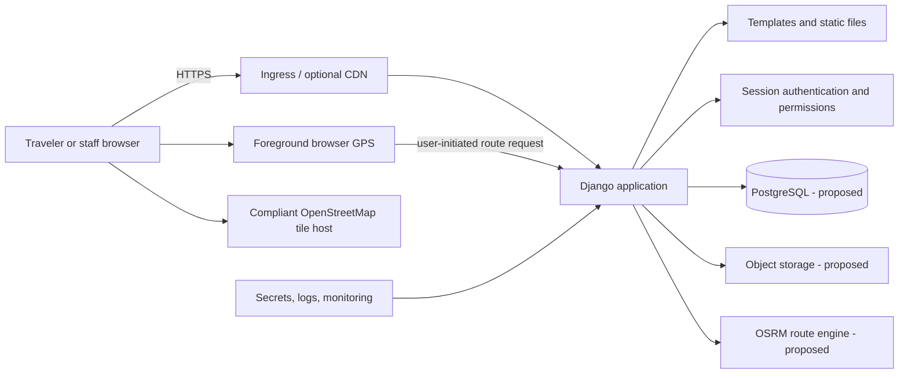

0# KumariQuest

> **Project status:** Existing Django prototype and proposed roadmap. Some features are partial; this README distinguishes what is present from what is planned. The JSON API and production architecture are not implemented.

KumariQuest is a web application for discovering destinations in Kanyakumari and creating a basic preference-driven trip itinerary.

## Problem statement

Travelers may need to use multiple sources to learn about local destinations and organize a short visit. KumariQuest aims to bring destination information and basic trip planning into one approachable website.

## Objectives

- Make destination browsing and details straightforward.
- Generate a simple itinerary from duration, interests, trip type, and budget.
- Provide account/profile features for travelers.
- Build a secure, testable foundation that can be operated responsibly.

## Features

### Present in the repository

- Django server-rendered destination list, details, and client-side category/search filtering.
- Preference-driven itinerary form (1–5 days, category, trip type, budget).
- Username/password registration and login, profile and optional profile-image model.
- Trip preference records for authenticated planner submissions.
- Models and partial views for favorites, notifications, and site-wide feedback.
- Safety/about pages and Django admin registrations.
- External map links/embedded destination map. Live GPS route navigation is not yet implemented.

### Partial or planned

- Favorites have a model and profile display, but complete add/remove flows are not implemented.
- Stored trips currently capture preferences, not generated itinerary stops.
- Notification creation/delivery policy is not established; read state should be changed via a CSRF-protected mutation, not GET.
- Reviews are currently site-wide, without an established moderation workflow.
- **Approved planned launch feature:** foreground-only browser GPS with walking/driving route overview (live position, route, distance/ETA), no voice/turn-by-turn, no location-history storage. The existing destination-page script is incomplete and is not a working implementation.
- Versioned JSON API, production deployment, comprehensive automated tests, accessibility validation, and operational monitoring are planned, not present.

## Technology stack

| Area | Current / proposed |
|---|---|
| Backend | Django 6.1.1 (current project pin), Python 3.14 in the configured local environment |
| Frontend | Django templates, HTML, CSS, small JavaScript |
| Local database | SQLite |
| Production database (proposed) | PostgreSQL |
| Images | Django `ImageField`; production object storage is not yet configured |
| API (proposed) | Django REST Framework, only after API scope approval |
| Maps/navigation | Planned: Leaflet + OpenStreetMap-compatible tiles + OSRM-based walking/driving route overview; tile/routing host, terms, privacy, and operating cost remain to be selected |

The current [`requirements.txt`](requirements.txt) contains a large set of packages beyond the app's apparent direct requirements. A minimal, reproducible application dependency manifest is a planned maintenance task.

## System architecture

The current application is a Django monolith. The proposed production deployment keeps one Django service, adds managed PostgreSQL and object storage, and optionally exposes a versioned JSON API. It does not require microservices or a separate SPA.



## Database overview

Current domain entities:

- Django `User` → one `Profile`.
- `User` → many `TripPlan` preference records, `Favorite`s, `Notification`s, and `Review`s.
- `Destination` → many `Favorite`s.
- Current `Review` is site-wide (no destination foreign key).
- User GPS is held only in active page memory during navigation; the proposed design adds no location-history table or database field.

Production-oriented constraints/indexes and any persisted itinerary-stop schema are documented in [`DATABASE_DESIGN.md`](DATABASE_DESIGN.md). No production database is configured in this repository.

## Project structure

```text
KumariQuest/
├── accounts/                 # Authentication and traveler profile
├── kumariquest/              # Django settings and root URL configuration
├── planner/                  # Trip preference and itinerary flow
├── tourism/                  # Destinations, favorites, reviews, notifications
├── templates/                # Server-rendered HTML templates
├── manage.py                 # Django command-line entry point
├── requirements.txt          # Existing broad pinned dependency list
└── README.md
```

Detailed target structure and checkpoint responsibilities are in [`IMPLEMENTATION_PLAN.md`](IMPLEMENTATION_PLAN.md).

## Prerequisites

- Python version compatible with the project's pinned Django version (the current environment uses Python 3.14).
- Git.
- A virtual environment.
- PostgreSQL only when configuring the proposed production database; local default is SQLite.

## Local environment setup

From the repository root in PowerShell:

```powershell
py -3.14 -m venv .venv
.\.venv\Scripts\Activate.ps1
python -m pip install --upgrade pip
```

The current requirements file includes unrelated packages and should not be installed wholesale without review. For a minimal local run, install the current application's direct runtime dependencies:

```powershell
python -m pip install "Django==6.1.1" "Pillow==11.3.0"
```

These are the versions used during the current local verification; confirm supported versions and create a reviewed app-specific lock before team/production use.

## Database and migrations

The default settings use SQLite at `db.sqlite3` (ignored by Git). Create/apply schema:

```powershell
python manage.py migrate
```

For production, configure PostgreSQL through environment-based settings before deployment. Do not commit credentials or production database files. Database creation, production settings, backup policy, and migration release procedure are planned.

## Run the application

```powershell
python manage.py check
python manage.py runserver
```

Open `http://127.0.0.1:8000/`. The current root page is the login screen; other pages include `/home/`, `/explore/`, and `/planner/`. Development server is for local use only, not production.

Optional administrator account for local development:

```powershell
python manage.py createsuperuser
```

## API documentation

No JSON API is implemented at this time. The proposed `/api/v1/` contract, authentication behavior, request/response examples, and errors are specified in [`API_DOCUMENTATION.md`](API_DOCUMENTATION.md); endpoints must not be treated as available until implemented and tested.

## Testing

Run the current Django test command:

```powershell
python manage.py test
```

The current repository discovers zero tests. See [`TESTING_STRATEGY.md`](TESTING_STRATEGY.md) for proposed unit, integration, API, authorization, security, accessibility, and end-to-end coverage. Release readiness requires adding tests; an empty test run is not evidence of feature correctness.

## Screenshots

Screenshots are placeholders until reviewed UI captures are added:

| Page | Screenshot |
|---|---|
| Home and destination discovery | _TODO: add approved screenshot_ |
| Destination details | _TODO: add approved screenshot_ |
| Trip planner | _TODO: add approved screenshot_ |
| Profile and account features | _TODO: add approved screenshot_ |

Do not include real user data, account details, or private locations in screenshots.

## Future enhancements

- Complete favorites and owned-trip workflows.
- Decide whether to persist full itinerary stops.
- Add review moderation and agreed site-wide or destination-specific behavior.
- Add the documented versioned JSON API if approved.
- Improve destination content provenance and administration workflow.
- Implement the approved foreground live-map and route overview after selecting a compliant tile host and OSRM deployment/hosting approach.
- Add production settings, PostgreSQL, object storage, CI, monitoring, backups, and restore drills.
- Validate accessibility and responsive behavior.

## Known limitations

- Current settings are development-oriented (`DEBUG=True`, source-defined development secret, and no production host configuration).
- SQLite is configured; production deployment is not defined.
- Automated tests currently number zero.
- Favorites and notifications are incomplete user workflows.
- Trip records do not preserve generated day-by-day stops.
- Review model is site-wide and lacks an agreed moderation policy.
- Live GPS tracking/navigation is not yet implemented. The current map script is incomplete; the future feature is foreground-only, walking/driving route overview, and must not be advertised as functional until tested.
- Public OpenStreetMap tile servers and OSRM demo endpoints are not an unlimited production service; a compliant, monitored tile/routing arrangement remains a launch dependency.
- No license has been selected. Do not assume code, images, destination data, or copy are licensed for redistribution.

## Contributing

Contributions should follow the approved scope and architecture:

1. Open an issue describing the requirement and acceptance criteria.
2. Keep changes focused; add tests for introduced behavior and authorization boundaries.
3. Do not commit secrets, user uploads, database files, or unlicensed content.
4. Run Django checks, migration checks, and tests before submitting a pull request.
5. Document schema/API changes and security/privacy implications.

Detailed implementation gates are in [`IMPLEMENTATION_PLAN.md`](IMPLEMENTATION_PLAN.md). A formal contribution policy and code of conduct remain to be adopted.

## License

**Not selected.** No permission to use, modify, or redistribute this project should be inferred until the owner chooses and adds a license. Confirm rights for all third-party images, map data, and destination content.

## Project documents

- [Project analysis](PROJECT_ANALYSIS.md)
- [Architecture](ARCHITECTURE.md)
- [Implementation plan and roadmap](IMPLEMENTATION_PLAN.md)
- [Database design](DATABASE_DESIGN.md)
- [Proposed API documentation](API_DOCUMENTATION.md)
- [Testing strategy](TESTING_STRATEGY.md)
- [Security review](SECURITY_REVIEW.md)
